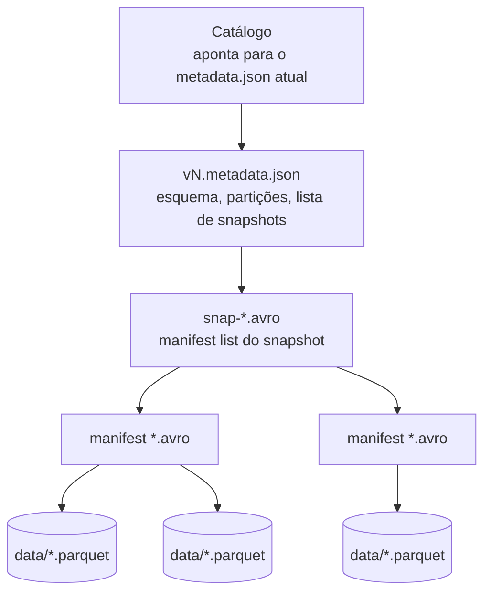

# Apache Iceberg

## O que é

O **Apache Iceberg** é um formato de tabela aberto criado na Netflix e doado para a Apache Software Foundation.
Assim como o Delta, os dados ficam em arquivos **Parquet** e uma camada de metadados transforma esses arquivos
em uma tabela com `UPDATE`, `DELETE`, transações e histórico.

A diferença está em **como** os metadados são organizados. Em vez de um diário de alterações, o Iceberg trabalha
com **snapshots**: a cada alteração, ele tira uma "foto" da tabela, dizendo exatamente quais arquivos fazem parte
dela naquele momento. É como um álbum de fotos de um cômodo: para saber como a sala estava em março, você não
relê tudo o que aconteceu — só abre a foto de março.



```text
spark-warehouse/iceberg/academia/alunos/
├── data/
│   └── 00000-....parquet            ← dados
└── metadata/
    ├── v1.metadata.json             ← uma versão do metadata por alteração
    ├── v2.metadata.json
    ├── ...
    ├── snap-....avro                ← manifest list (um por snapshot)
    ├── ....-m0.avro                 ← manifests (apontam para os .parquet)
    └── version-hint.text            ← qual é o metadata.json atual (catálogo hadoop)
```

## Catálogos

No Iceberg, toda tabela pertence a um **catálogo** — o "cartório" que sabe onde está a versão atual de cada tabela.
Existem vários tipos (Hive, REST, Glue, Nessie...). No trabalho usamos o tipo **`hadoop`**, que guarda tudo em
pastas no disco local e não precisa de nenhum servidor. Por isso os nomes das tabelas têm três partes:

```text
local . academia . alunos
  │        │         └── tabela
  │        └── namespace (equivalente ao "banco")
  └── catálogo configurado na SparkSession
```

## Configuração no Spark

```python
from pyspark.sql import SparkSession

spark = (
    SparkSession.builder
    .appName("SparkIceberg")
    .master("local[*]")
    .config("spark.jars.packages", "org.apache.iceberg:iceberg-spark-runtime-3.5_2.12:1.6.1")
    .config("spark.sql.extensions", "org.apache.iceberg.spark.extensions.IcebergSparkSessionExtensions")
    .config("spark.sql.catalog.local", "org.apache.iceberg.spark.SparkCatalog")
    .config("spark.sql.catalog.local.type", "hadoop")
    .config("spark.sql.catalog.local.warehouse", "spark-warehouse/iceberg")
    .getOrCreate()
)
```

Diferente do Delta, **não há biblioteca Python a instalar**: tudo vem no `.jar` baixado pelo `spark.jars.packages`.

## DDL

```sql
CREATE NAMESPACE IF NOT EXISTS local.academia;

CREATE TABLE IF NOT EXISTS local.academia.planos (
    id_plano      INT,
    nome          STRING,
    valor_mensal  DECIMAL(10,2),
    duracao_meses INT
) USING iceberg;

CREATE TABLE IF NOT EXISTS local.academia.alunos (
    id_aluno       INT,
    nome           STRING,
    email          STRING,
    cidade         STRING,
    id_plano       INT,
    data_matricula DATE,
    ativo          BOOLEAN
) USING iceberg;

CREATE TABLE IF NOT EXISTS local.academia.checkins (
    id_checkin INT,
    id_aluno   INT,
    data_hora  TIMESTAMP,
    unidade    STRING
) USING iceberg
PARTITIONED BY (days(data_hora));
```

!!! tip "Particionamento oculto (*hidden partitioning*)"
    `PARTITIONED BY (days(data_hora))` particiona a tabela **por dia**, calculado a partir da coluna `data_hora`.
    Não é preciso criar uma coluna extra `dia` e lembrar de preenchê-la: o Iceberg calcula sozinho. E quem consulta
    filtra normalmente — `WHERE data_hora >= '2024-06-05'` — e o Iceberg já pula as partições que não interessam.
    Outras transformações: `years()`, `months()`, `hours()`, `bucket(N, col)`, `truncate(N, col)`.

## INSERT

=== "SQL"

    ```python
    spark.sql("""
    INSERT INTO local.academia.alunos VALUES
      (1, 'Ana Souza',     'ana@email.com',   'Criciúma',     1, DATE '2024-01-10', true),
      (2, 'Bruno Lima',    'bruno@email.com', 'Içara',        3, DATE '2024-02-05', true),
      (3, 'Carla Mendes',  'carla@email.com', 'Criciúma',     2, DATE '2024-03-12', true),
      (4, 'Diego Rocha',   'diego@email.com', 'Forquilhinha', 1, DATE '2024-04-20', false),
      (5, 'Elisa Martins', 'elisa@email.com', 'Criciúma',     3, DATE '2024-05-02', true)
    """)
    ```

=== "DataFrame (PySpark)"

    ```python
    from datetime import date

    novo_aluno = spark.createDataFrame(
        [(6, "Felipe Costa", "felipe@email.com", "Criciúma", 2, date(2024, 6, 10), True)],
        schema="id_aluno INT, nome STRING, email STRING, cidade STRING, "
               "id_plano INT, data_matricula DATE, ativo BOOLEAN",
    )
    novo_aluno.writeTo("local.academia.alunos").append()
    ```

Para Iceberg, a API recomendada para gravar DataFrames é a **`writeTo()`** (DataFrameWriterV2).

## UPDATE

```python
spark.sql("""
UPDATE local.academia.planos
SET valor_mensal = ROUND(valor_mensal * 1.10, 2)
WHERE nome = 'Mensal'
""")

spark.sql("UPDATE local.academia.alunos SET id_plano = 3 WHERE id_aluno = 1")
```

O resultado é o mesmo do Delta: o plano Mensal vai de **99.90** para **109.89** e a Ana passa para o plano 3.

!!! info "Copy-on-write × merge-on-read"
    Por padrão o Iceberg usa **copy-on-write**: reescreve os arquivos Parquet afetados (escrita mais lenta,
    leitura rápida). Também é possível configurar **merge-on-read**, em que o Iceberg grava apenas um pequeno
    arquivo dizendo "estas linhas foram apagadas/alteradas" e junta tudo na hora da leitura (escrita rápida,
    leitura um pouco mais lenta):

    ```sql
    ALTER TABLE local.academia.alunos SET TBLPROPERTIES (
      'write.update.mode' = 'merge-on-read',
      'write.delete.mode' = 'merge-on-read'
    );
    ```

## DELETE

```python
spark.sql("DELETE FROM local.academia.checkins WHERE id_aluno = 4")
spark.sql("DELETE FROM local.academia.alunos   WHERE id_aluno = 4")
```

Os check-ins 5 e 7 do Diego somem, e o cadastro dele também. Repare que, diferente do Delta, no Iceberg o
`UPDATE`/`DELETE` via `spark.sql` não devolve a contagem de linhas afetadas — conferimos com um `SELECT` logo depois.

## MERGE (upsert)

```python
spark.sql("""
MERGE INTO local.academia.alunos AS destino
USING atualizacoes_alunos AS origem
ON destino.id_aluno = origem.id_aluno
WHEN MATCHED THEN UPDATE SET *
WHEN NOT MATCHED THEN INSERT *
""")
```

Estado final de `alunos` — idêntico ao do Delta:

| id_aluno | nome | cidade | id_plano | O que aconteceu |
|---|---|---|---|---|
| 1 | Ana Souza | Criciúma | **3** | UPDATE (trocou de plano) |
| 2 | Bruno Lima | Içara | 3 | — |
| 3 | Carla Mendes | **Içara** | 2 | MERGE → atualizada |
| 5 | Elisa Martins | Criciúma | 3 | — |
| 6 | Felipe Costa | Criciúma | 2 | INSERT via DataFrame |
| 7 | Gabriela Alves | Criciúma | 1 | MERGE → inserida |

## Snapshots e *time travel*

O Iceberg expõe **tabelas de metadados** consultáveis por SQL, acrescentando um sufixo ao nome da tabela:

```python
spark.sql("""
SELECT committed_at, snapshot_id, parent_id, operation
FROM local.academia.alunos.snapshots
ORDER BY committed_at
""").show(truncate=False)
```

| # | operation | Origem |
|---|---|---|
| 1 | append | INSERT SQL |
| 2 | append | `writeTo().append()` do Felipe |
| 3 | overwrite | UPDATE |
| 4 | overwrite / delete | DELETE |
| 5 | overwrite | MERGE |

!!! note
    Diferente do Delta, o `CREATE TABLE` **não** gera snapshot — o primeiro aparece no primeiro INSERT.
    Os `snapshot_id` são números grandes gerados aleatoriamente, por isso no notebook o primeiro é buscado por consulta.

*Time travel* para o primeiro snapshot:

```python
primeiro = spark.sql("""
    SELECT snapshot_id FROM local.academia.alunos.snapshots
    ORDER BY committed_at LIMIT 1
""").first()["snapshot_id"]

spark.sql(f"SELECT * FROM local.academia.alunos VERSION AS OF {primeiro}").show()
```

Outras tabelas de metadados úteis: `.history`, `.files`, `.manifests`, `.partitions`.

## Delta Lake × Iceberg — resumo

| Aspecto | Delta Lake | Apache Iceberg |
|---|---|---|
| Origem | Databricks → Linux Foundation | Netflix → Apache Software Foundation |
| Metadados | diário `_delta_log/` (JSON + checkpoints Parquet) | árvore `metadata.json` → manifest list → manifests |
| Histórico | **versões** numeradas (0, 1, 2...) | **snapshots** com id aleatório |
| `CREATE TABLE` gera versão? | Sim (versão 0) | Não |
| Particionamento | por coluna explícita | **oculto**, com transformações (`days`, `bucket`...) |
| Catálogo | usa o catálogo padrão do Spark | catálogo próprio (hadoop, hive, REST, Glue...) |
| Biblioteca Python | `delta-spark` (API `DeltaTable`) | não precisa (só o `.jar`) |
| Ver histórico | `DESCRIBE HISTORY tabela` | `SELECT * FROM tabela.snapshots` |
| Time travel | `VERSION AS OF 1` | `VERSION AS OF <snapshot_id>` |
| Retorno de UPDATE/DELETE | contagem de linhas afetadas | sem retorno |

## Referências

- [Apache Iceberg — Spark Quickstart](https://iceberg.apache.org/spark-quickstart/)
- [Apache Iceberg — Spark Writes (UPDATE, DELETE, MERGE)](https://iceberg.apache.org/docs/1.6.1/spark-writes/)
- [Apache Iceberg — Spark Queries (time travel e tabelas de metadados)](https://iceberg.apache.org/docs/1.6.1/spark-queries/)
- [Maven: iceberg-spark-runtime-3.5](https://mvnrepository.com/artifact/org.apache.iceberg/iceberg-spark-runtime-3.5)
- [Projeto de exemplo do professor: jlsilva01/spark-iceberg](https://github.com/jlsilva01/spark-iceberg)
