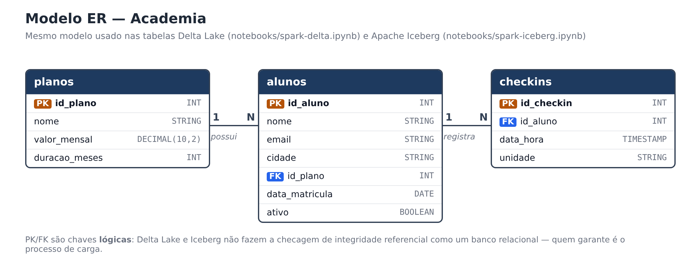
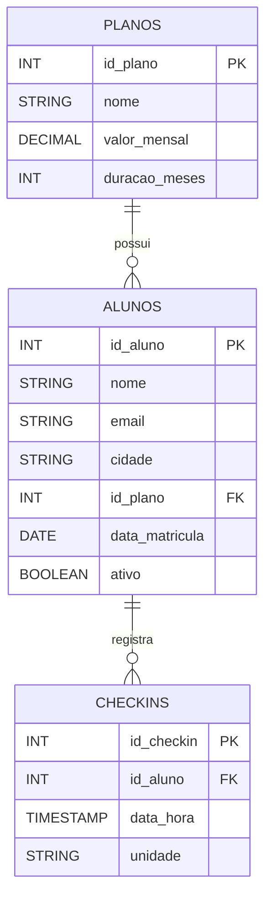

# Contexto do trabalho

Trabalho de pesquisa da disciplina de **Engenharia de Dados** sobre como o **Apache Spark** trabalha com dois
formatos de tabela abertos usados em *Data Lakehouses*: o **Delta Lake** e o **Apache Iceberg**.

!!! abstract "Objetivo"
    Montar **um único ambiente local** com PySpark e Jupyter e mostrar, na prática, os comandos
    **INSERT**, **UPDATE** e **DELETE** em tabelas Delta e em tabelas Iceberg — e o que acontece por baixo
    (versões, snapshots e arquivos no disco).

## O problema que esses formatos resolvem

Pense em uma planilha salva como PDF: dá para ler, mas não dá para corrigir uma célula — seria preciso gerar
o PDF de novo. Um *Data Lake* tradicional, feito só de arquivos **Parquet** em pastas, tem um problema parecido:
os arquivos são ótimos para leitura, mas **não existe "alterar uma linha"**. Para corrigir um dado, reescreve-se
a pasta inteira, e se o processo cair no meio, a tabela fica pela metade.

**Delta Lake** e **Apache Iceberg** resolvem isso colocando uma **camada de metadados** (um "índice com histórico")
em cima dos arquivos Parquet. Com ela ganhamos:

- `UPDATE`, `DELETE` e `MERGE` como em um banco relacional;
- transações **ACID** (ou a alteração acontece inteira, ou não acontece);
- **histórico de versões** e *time travel* (consultar a tabela como ela era antes);
- evolução de esquema (adicionar colunas sem reescrever tudo).

Essa combinação — arquivos baratos de Data Lake + recursos de banco de dados — é o que se chama de **Lakehouse**.

## Cenário: academia

Para os exemplos foi criado um cenário simples de **academia**:

- a academia vende **planos** (Mensal, Trimestral, Anual);
- cada **aluno** está matriculado em um plano;
- cada vez que o aluno passa na catraca, é gravado um **check-in**.

### Modelo ER

O mesmo modelo em formato Mermaid:

!!! warning "PK e FK são lógicas"
    Delta Lake e Iceberg **não bloqueiam** chave duplicada nem chave estrangeira inexistente, como faria um
    PostgreSQL. As chaves do diagrama documentam a intenção do modelo; quem garante a integridade é o processo de carga.

### Conjunto de dados

O conjunto de dados **foi criado pelo grupo** (nenhum dataset externo foi baixado). São poucos registros,
escritos direto nos `INSERT`, para que o efeito de cada `UPDATE` e `DELETE` possa ser conferido a olho:

=== "planos (3)"

    | id_plano | nome | valor_mensal | duracao_meses |
    |---|---|---|---|
    | 1 | Mensal | 99.90 | 1 |
    | 2 | Trimestral | 269.70 | 3 |
    | 3 | Anual | 899.00 | 12 |

=== "alunos (5 + 1 via DataFrame)"

    | id_aluno | nome | cidade | id_plano | data_matricula | ativo |
    |---|---|---|---|---|---|
    | 1 | Ana Souza | Criciúma | 1 | 2024-01-10 | true |
    | 2 | Bruno Lima | Içara | 3 | 2024-02-05 | true |
    | 3 | Carla Mendes | Criciúma | 2 | 2024-03-12 | true |
    | 4 | Diego Rocha | Forquilhinha | 1 | 2024-04-20 | false |
    | 5 | Elisa Martins | Criciúma | 3 | 2024-05-02 | true |
    | 6 | Felipe Costa | Criciúma | 2 | 2024-06-10 | true |

=== "checkins (8)"

    | id_checkin | id_aluno | data_hora | unidade |
    |---|---|---|---|
    | 1 | 1 | 2024-06-03 07:15 | Centro |
    | 2 | 2 | 2024-06-03 18:40 | Próspera |
    | 3 | 1 | 2024-06-04 07:05 | Centro |
    | 4 | 3 | 2024-06-04 19:10 | Centro |
    | 5 | 4 | 2024-06-05 06:50 | Próspera |
    | 6 | 5 | 2024-06-05 12:30 | Centro |
    | 7 | 4 | 2024-06-06 06:55 | Próspera |
    | 8 | 2 | 2024-06-06 18:20 | Próspera |

## Roteiro executado nos dois formatos

Os dois notebooks seguem **exatamente o mesmo roteiro**, para facilitar a comparação:

| # | Etapa | Exemplo |
|---|---|---|
| 1 | DDL | criar `planos`, `alunos` e `checkins` |
| 2 | INSERT | carga inicial via SQL + 1 aluno via DataFrame |
| 3 | UPDATE | reajuste de 10% no plano Mensal; Ana troca para o plano Anual |
| 4 | DELETE | aluno Diego (inativo) cancela: apaga check-ins e cadastro |
| 5 | MERGE | Carla muda de cidade (atualiza) e Gabriela se matricula (insere) |
| 6 | Histórico | versões (Delta) / snapshots (Iceberg) e *time travel* |

Os detalhes de cada formato estão nas páginas [Delta Lake](delta.md) e [Apache Iceberg](iceberg.md).
Os conceitos do motor de processamento estão em [Apache Spark (PySpark)](spark.md).

## Ambiente utilizado

| Componente | Versão |
|---|---|
| Sistema operacional | Linux Ubuntu 24.04 LTS |
| Java (OpenJDK) | 17 |
| Python | 3.11 |
| Gerenciador de projeto/pacotes | [uv](https://docs.astral.sh/uv/) |
| PySpark | 3.5.3 |
| delta-spark | 3.2.0 |
| iceberg-spark-runtime-3.5_2.12 | 1.6.1 |
| JupyterLab / ipykernel | 4.x / 7.x |
| MkDocs + Material | 1.6 / 9.x |

!!! tip "Como reproduzir"
    O passo a passo completo de instalação e execução está no **README** do repositório.
    Esta documentação explica **o conteúdo** do trabalho; o README explica **como rodar**.

## Integrantes

- Kamily Hilário das Luzes — Kauã Lucas Alves Barbosa
