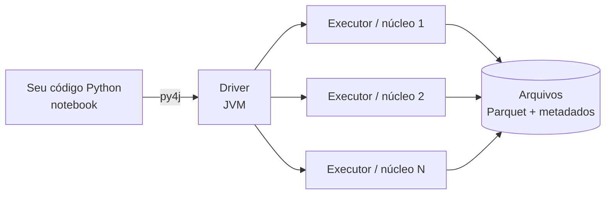

# Apache Spark (PySpark)

## O que é

Imagine que você precisa contar todas as palavras de uma biblioteca inteira. Sozinho levaria meses; se você
dividir os livros entre 100 pessoas e depois somar os resultados, termina em um dia. O **Apache Spark** faz
exatamente isso com dados: é um **motor de processamento distribuído** que quebra um volume grande de dados em
pedaços, processa os pedaços em paralelo (em vários núcleos ou várias máquinas) e junta o resultado.

O **PySpark** é a biblioteca que permite usar o Spark escrevendo **Python**. O Spark em si é escrito em
Scala e roda na **JVM (Java)** — por isso é obrigatório ter o **Java instalado**, mesmo programando só em Python.



## Conceitos principais

**SparkSession** — a "porta de entrada". Toda aplicação começa criando uma; é nela que dizemos quais
extensões usar (Delta, Iceberg) e onde gravar as tabelas.

```python
from pyspark.sql import SparkSession

spark = (
    SparkSession.builder
    .appName("MeuApp")
    .master("local[*]")   # roda na própria máquina usando todos os núcleos
    .getOrCreate()
)
```

**`local[*]`** — no trabalho o Spark roda em **modo local**: o "cluster" é o próprio computador e cada núcleo
do processador faz o papel de um executor. O mesmo código roda em um cluster de verdade só trocando o `master`.

**DataFrame** — uma tabela distribuída, com colunas e tipos, parecida com uma tabela SQL ou um DataFrame do pandas
— só que os dados podem estar espalhados por várias máquinas.

```python
df = spark.createDataFrame(
    [(1, "Ana"), (2, "Bruno")],
    schema="id INT, nome STRING",
)
df.show()
```

**Spark SQL** — os mesmos dados podem ser manipulados com SQL comum. No trabalho usamos principalmente
`spark.sql("...")`, porque deixa os comandos `INSERT`, `UPDATE` e `DELETE` mais fáceis de ler:

```python
spark.sql("SELECT nome FROM academia.alunos WHERE ativo = true").show()
```

**Avaliação preguiçosa (*lazy evaluation*)** — o Spark só executa de verdade quando você pede um resultado
(`show()`, `count()`, gravar). Até lá ele apenas monta um plano, o que permite otimizar a execução inteira de uma vez.
É como anotar a lista de compras antes de ir ao mercado, em vez de ir uma vez para cada item.

## Spark + formatos de tabela

Sozinho, o Spark lê e grava Parquet, CSV, JSON etc., mas **não sabe fazer `UPDATE` ou `DELETE`** em arquivos.
É aí que entram o Delta Lake e o Iceberg: eles são distribuídos como um **pacote `.jar`** que se conecta ao Spark
por três tipos de configuração:

| Configuração | Papel | Delta | Iceberg |
|---|---|---|---|
| `spark.jars.packages` | qual `.jar` baixar do Maven | `io.delta:delta-spark_2.12:3.2.0` | `org.apache.iceberg:iceberg-spark-runtime-3.5_2.12:1.6.1` |
| `spark.sql.extensions` | novos comandos SQL | `DeltaSparkSessionExtension` | `IcebergSparkSessionExtensions` |
| `spark.sql.catalog.*` | onde ficam as tabelas | substitui o `spark_catalog` | cria um catálogo novo (`local`) |

!!! info "Por que as versões precisam combinar"
    O nome dos pacotes carrega duas versões: **`3.5`** é a versão do Spark e **`2.12`** é a versão do Scala com que
    o Spark foi compilado. Com PySpark 3.5.3, os `.jar` precisam ser "para Spark 3.5" e "Scala 2.12";
    usar outra combinação gera erros como `ClassNotFoundException` ou `NoSuchMethodError`.

    - Compatibilidade Delta × Spark: [docs.delta.io/latest/releases.html](https://docs.delta.io/latest/releases.html)
    - Compatibilidade Iceberg × Spark: [iceberg.apache.org/multi-engine-support](https://iceberg.apache.org/multi-engine-support/)

!!! note "Primeira execução"
    Na primeira vez que a SparkSession é criada, o Spark baixa os `.jar` do Maven Central e guarda em `~/.ivy2`.
    Por isso precisa de internet e demora um pouco mais. Depois disso, fica em cache.

## Referências

- [Documentação oficial do Apache Spark 3.5](https://spark.apache.org/docs/3.5.3/)
- [PySpark — Getting Started](https://spark.apache.org/docs/3.5.3/api/python/getting_started/index.html)
- [Spark SQL — Guia](https://spark.apache.org/docs/3.5.3/sql-programming-guide.html)
- [Canal DataWay BR no YouTube](https://www.youtube.com/@datawaybr)
